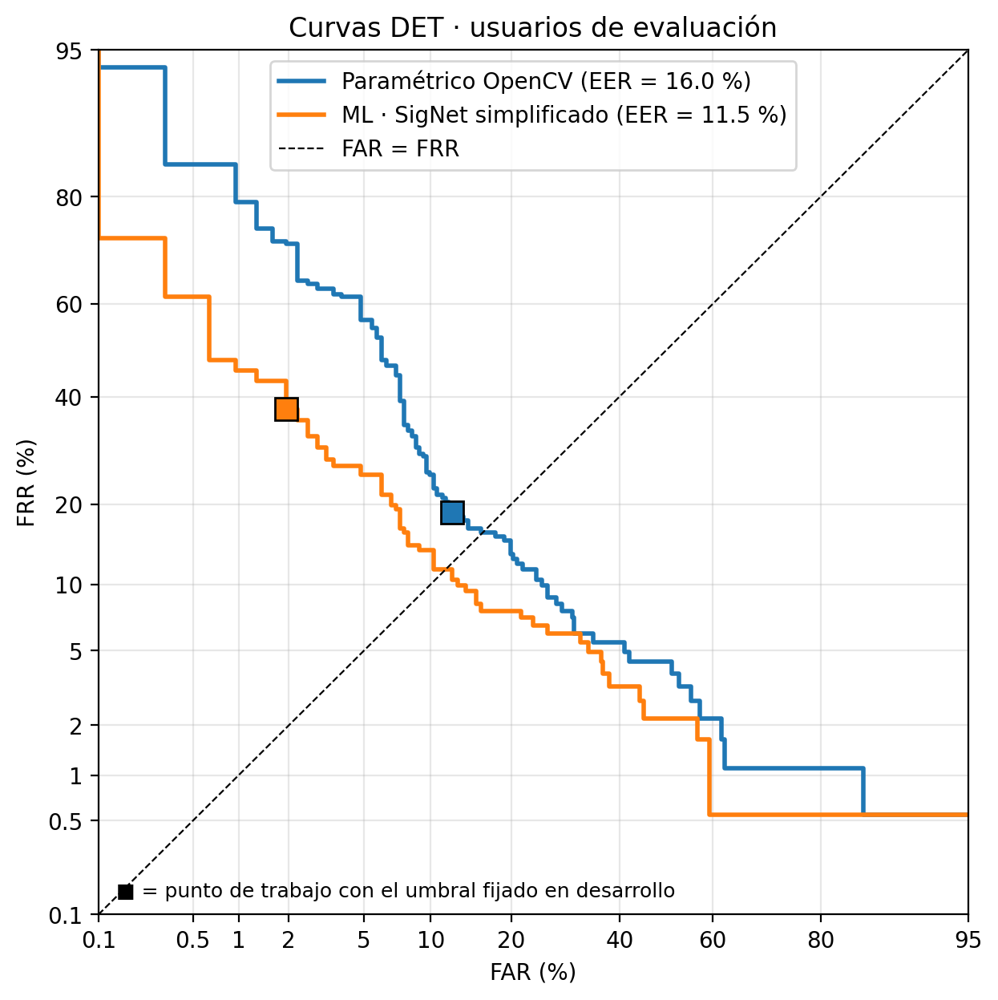

# Verificación de firmas manuscritas offline

Práctica de **Procesamiento de Imágenes, Audio y Vídeo (PIAV)**, Grado en Ciencia e Ingeniería de Datos.

Se comparan dos verificadores de firmas sobre la base de datos **CEDAR**:

1. **Sistema paramétrico (OpenCV):** preprocesado (mediana, Otsu, limpieza, recorte), 13 características geométricas (densidad de tinta, relación ancho/alto, centroide, componentes conexas, momentos de Hu, tinta por cuadrantes, inclinación) y una puntuación basada en la distancia z al patrón del usuario.
2. **Sistema de aprendizaje automático:** versión simplificada de SigNet ([Hafemann et al., 2017](https://doi.org/10.1016/j.patcog.2017.05.012)). Una ResNet18 preentrenada en ImageNet se ajusta para clasificar escritores, se usa como extractor de características y la puntuación es la similitud coseno con las 10 firmas de referencia.

## Hipótesis

**H1 · Sistema paramétrico (OpenCV).** Las firmas genuinas de un usuario varían poco entre sí en sus características geométricas globales (densidad de tinta, proporción, centroide, componentes conexas, momentos de Hu, distribución por cuadrantes, inclinación), y menos que las falsificaciones hábiles respecto a ellas. Por tanto, la distancia z media de una firma al patrón construido con 10 referencias permite verificarla con un error moderado. Sin embargo, el error será limitado por abajo (EER alto, del orden del 15–25 %), porque un falsificador hábil imita precisamente la forma global, que es lo que miden estas características.

**H2 · Sistema de aprendizaje automático (SigNet simplificado).** Una CNN preentrenada en ImageNet y ajustada para identificar escritores con usuarios de desarrollo aprende rasgos finos del trazo que generalizan a usuarios no vistos. Por ello obtendrá un **EER menor que el sistema paramétrico** con los mismos usuarios de evaluación. Además, el número de épocas de ajuste fino (hiperparámetro estudiado: 0, 10, 30, 60) reducirá el EER respecto a usar solo ImageNet (0 épocas), hasta un punto a partir del cual dejará de mejorar.

**Cómo se contrastan:** ambas se evalúan con el mismo protocolo (referencias 1–10; genuinas 11–24 y 24 falsificaciones de prueba) mediante el EER, la curva DET y la FAR y la FRR con el umbral fijado en desarrollo. Los hiperparámetros y el umbral se eligen solo con usuarios de desarrollo (1–30), y el resultado se mide en evaluación (31–43).

## Resultados (usuarios de evaluación 31–43)

| Sistema | EER | FAR (umbral fijo) | FRR (umbral fijo) |
|---|---|---|---|
| Paramétrico OpenCV | 16,0 % | 12,2 % | 18,7 % |
| ML · SigNet simplificado | ~11,3 % | ~2 % | ~38 % |



## Estructura

| Archivo | Contenido |
|---|---|
| `practica_firmas.ipynb` | Notebook completo: datos, evaluación, los dos sistemas, comparación y prueba final |
| `modelo_signet_resnet18.pt` | Modelo ML entrenado (se usa sin reentrenar en la prueba final) |
| `det_comparacion.png` | Curvas DET de ambos sistemas |
| `puntuaciones_ensayo.csv` | Ensayo del CSV de la prueba final (`usuario, firma, tipo, puntuacion, decision`) |

## Ejecución

1. Descargar la base de datos del Campus Virtual y descomprimirla así:
   ```
   data/genuinas/full_org/full_org/original_<usuario>_<n>.png
   data/falsificadas/full_forg/full_forg/forgeries_<usuario>_<n>.png
   ```
2. Instalar las dependencias:
   ```
   pip install opencv-python numpy pandas scipy matplotlib scikit-learn torch torchvision
   ```
3. Ejecutar `practica_firmas.ipynb` de principio a fin. Con GPU tarda unos 2 minutos.

**Prueba final con usuarios nuevos:** en la última sección del notebook, cambiar las rutas `DIR_GEN_NUEVOS` y `DIR_FORG_NUEVOS` y quitar `usuarios=USR_EVAL`.

## Referencia

Hafemann, L. G., Sabourin, R., & Oliveira, L. S. (2017). Learning features for offline handwritten signature verification using deep convolutional neural networks. *Pattern Recognition, 70*, 163–176. https://doi.org/10.1016/j.patcog.2017.05.012
